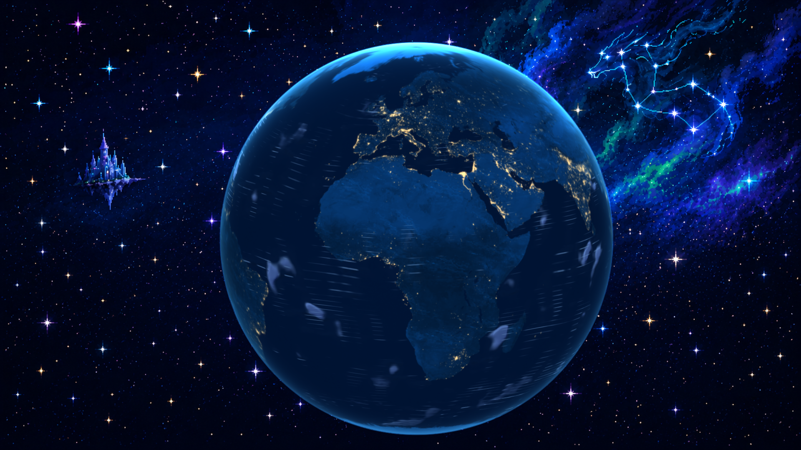

# Planet Wallpaper

Анимированная пиксельная Земля для Linux/Wayland, Quickshell и Niri.
Географическая поверхность вращается без дрожания, облака живут в отдельной
погодной модели, а солнечная засветка зависит от проходящей поверхности.



[Движение облаков на ×10 при неподвижной поверхности](media/cloud-motion-x10.mp4).

## Возможности

- Два ракурса Земли: крупный горизонт и полный шар.
- Шесть облачных полей: кучевые, слоистые, слоисто-кучевые, перистые,
  чечевицеобразные и грозовые. Восстановлены тонкие облачные полосы.
- Перенос ветрами, конденсация, испарение, осадки и изменение формы облаков.
- Общий поворот поверхности и облаков; дополнительное движение задают ветры.
- Остановка расчёта погоды с сохранением облаков и продолжение без скачка времени.
- Сохранённая палитра v6, мягкие городские огни и засветка верхней дуги из v8.
- Дополнительная художественная композиция с Венерой.
- Общий анимированный фон Niri под прозрачными рабочими столами, включая обзор.

Это художественная модель погоды, а не метеорологический прогноз.
Приложение работает локально, без API-ключей, сетевых запросов и телеметрии.

## Требования

Linux/Wayland, Quickshell (`qs` или `quickshell`), Qt 6 с Qt Quick и
Shader Tools (`qsb`), Python 3.12+ и пользовательский systemd.
Нужен графический backend RHI/OpenGL; software backend Qt Quick не исполняет
используемые ShaderEffect.

Проверено на Qt 6.12, Quickshell-совместимом `qs` и Niri 26.04.
Путь к инструментам Qt можно задать через `QT_TOOLS_DIR`.

## Сборка и установка

```sh
git clone https://github.com/DmitryKlo/planet-wallpaper.git
cd planet-wallpaper
python3 scripts/build.py
python3 scripts/install.py --start
```

Сборка проверяет SHA-256 четырёх ресурсов и компилирует GLSL локальным `qsb`.
Готовая конфигурация находится в `build/runtime/`.

Установка копирует её в `$XDG_CONFIG_HOME/quickshell/planet-wallpaper`
(по умолчанию `~/.config/quickshell/planet-wallpaper`), устанавливает команду
`~/.local/bin/planet-wallpaper` и пользовательский сервис.
Существующий `settings.json` сохраняется. Предыдущая установка копируется в
`$XDG_DATA_HOME/planet-wallpaper-install-backups/`.
Убедитесь, что `~/.local/bin` входит в `PATH`.

Для установки без запуска сервиса опустите `--start`.
`--no-systemd` полностью отключает обращения установщика к systemd.
Установщик не меняет конфигурацию Niri и настройки оболочки.

## Настройка Niri

Перенесите блоки из [config/niri.kdl](config/niri.kdl) в свою конфигурацию,
объединив их с существующими `layout` и `overview`. Затем:

```sh
niri validate
niri msg action load-config-file
```

Анимация использует слой `Background`. Правило `place-within-backdrop true`
оставляет её в общем фоне при переключении рабочих столов. Прозрачный
`layout.background-color` и выключенная тень рабочего стола убирают отдельные
подложки в обзоре. [Описание общего фона в документации Niri](https://github.com/niri-wm/niri/blob/main/docs/wiki/Overview.md).

По умолчанию анимация работает самостоятельно и не требует Noctalia.
При необходимости можно включить `followNoctaliaWallpaper` и указать `image`
в локальном `settings.json`: тогда анимация показывается только при выборе
этого изображения в Noctalia. Не добавляйте личный `settings.json` в Git.

## Управление

```sh
planet-wallpaper status
planet-wallpaper pause
planet-wallpaper resume
planet-wallpaper speed 1
planet-wallpaper speed 10
planet-wallpaper view horizon
planet-wallpaper view globe
planet-wallpaper view venus
planet-wallpaper weather off
planet-wallpaper weather on
planet-wallpaper off
planet-wallpaper on
```

При стандартном периоде один оборот длится 360 секунд, на ×10 — 36 секунд.
Обороту соответствуют сутки модели: обычная секунда анимации равна 240 секундам
модели. Скорость влияет на оба времени. `weather off` замораживает состояние
и мелкие волокна; вращение планеты продолжается.

## Проверки

```sh
python3 scripts/audit.py --history
python3 -m unittest discover -s tests -v
python3 scripts/build.py
```

Полная проверка настоящих GPU-полей требует NumPy, Pillow, `qml` и Mesa/драйвера
с поддержкой OpenGL:

```sh
python3 scripts/run_native.py --full
```

Она проверяет развитие всех шести полей, сброс, отсутствие облаков без
конденсата, остановку/продолжение, часы ×1/×10, 144 ракурса и изменение облаков
над неподвижной географией. Результаты остаются в игнорируемой `build/test-output/`.
GitHub Actions проверяет упаковку, ресурсы, историю на типовые секреты и сборку
шейдеров; GPU-проверки выполняются отдельно.

Для одиночного кадра после сборки:

```sh
mkdir -p build/preview
QT_QPA_PLATFORM=offscreen QT_QUICK_BACKEND=rhi QSG_RHI_BACKEND=opengl \
  /usr/lib/qt6/bin/qml build/runtime/Render.qml -- \
  --output="$PWD/build/preview" --frames=1 --span=0 --globe=1
```

## Структура и происхождение материалов

`src/` — текущий движок, `assets/` — четыре необходимых ресурса,
`scripts/` — сборка, установка и проверки, `tests/native/` — нативные QML-проверки.
Старые сборки, записи рабочего стола, журналы, пользовательские настройки,
резервные копии и история разработки с локальной машины не включены.

Подробности: [архитектура](docs/architecture.md), [материалы и атрибуция](docs/assets.md),
[проверка секретов](SECURITY.md).

Лицензия на распространение кода и художественных материалов пока не выбрана.
Репозиторий подготовлен как приватный; происхождение исходного художественного
фона не даёт оснований объявлять его свободно распространяемым.
